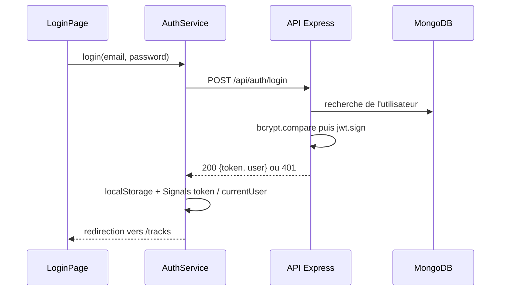
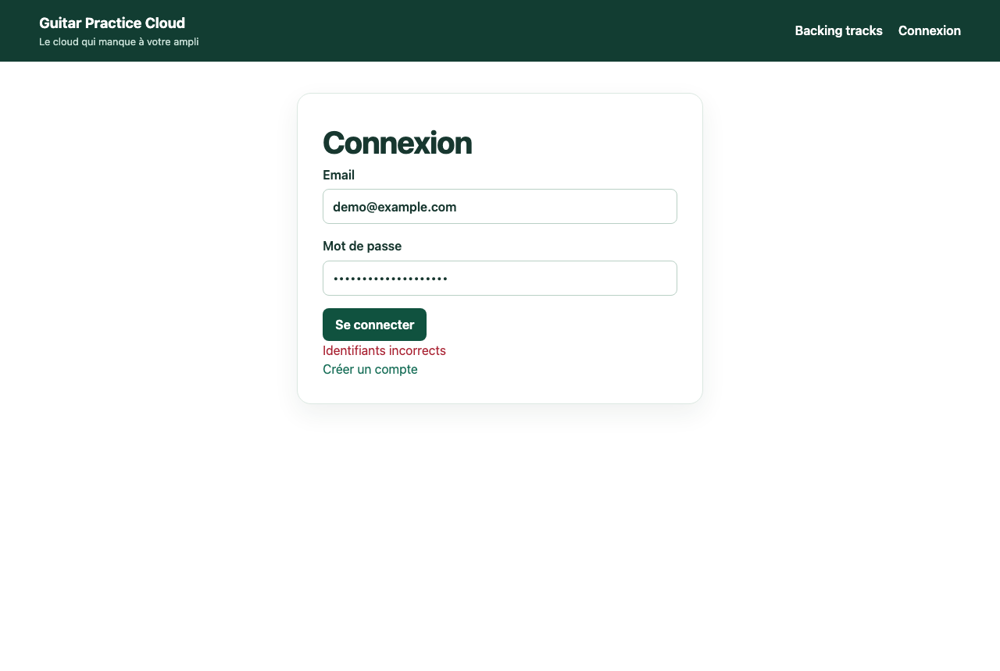
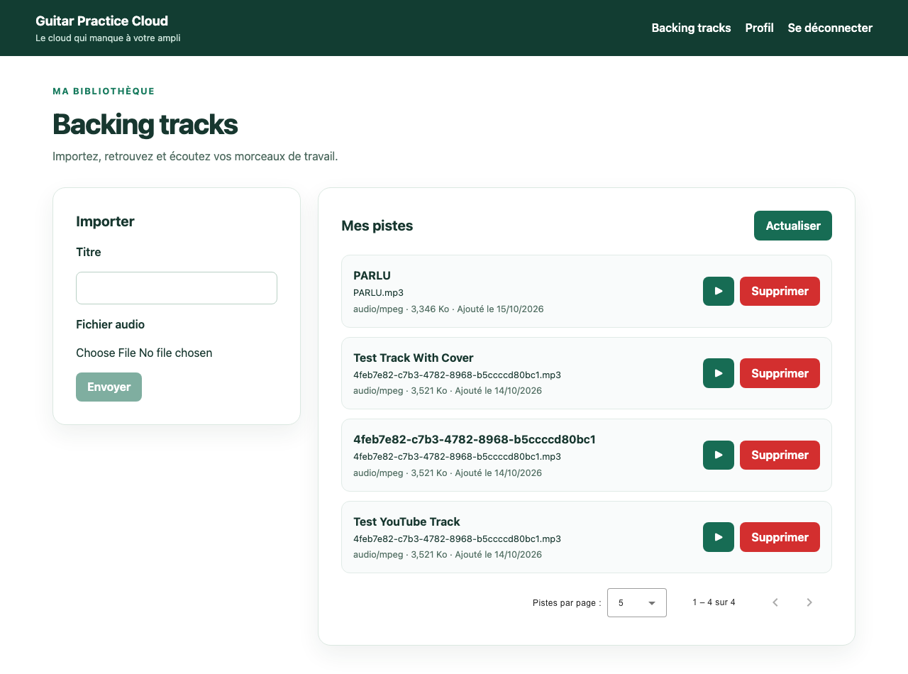
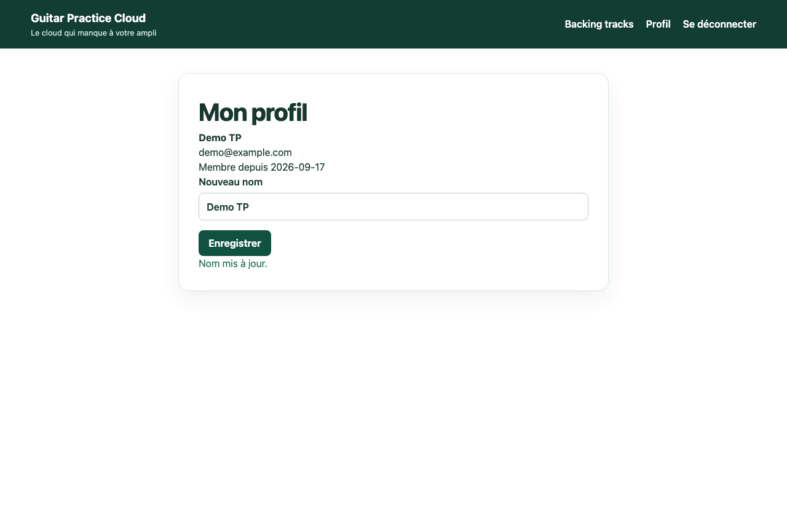
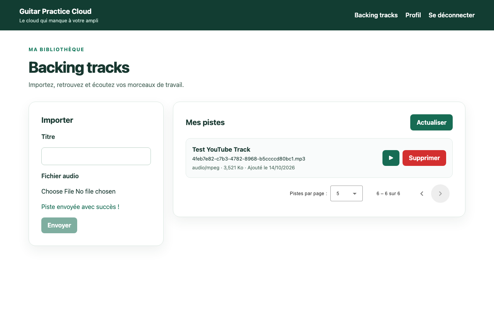
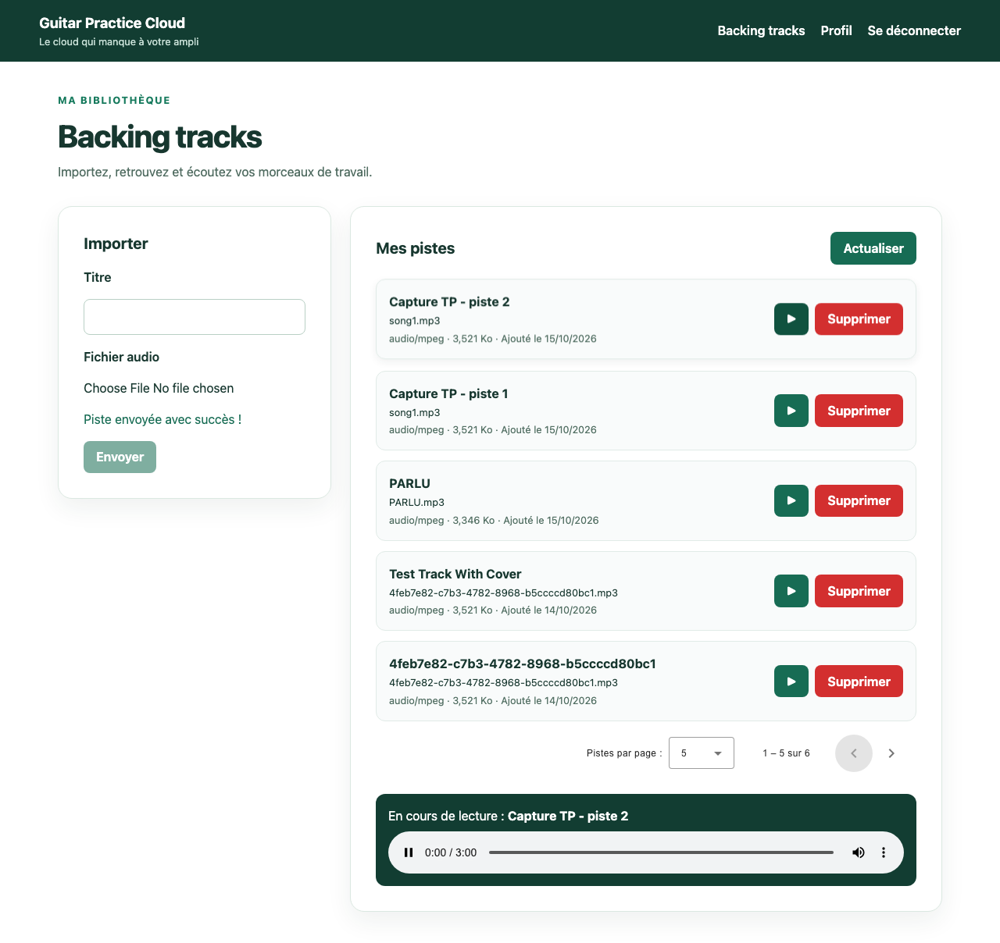
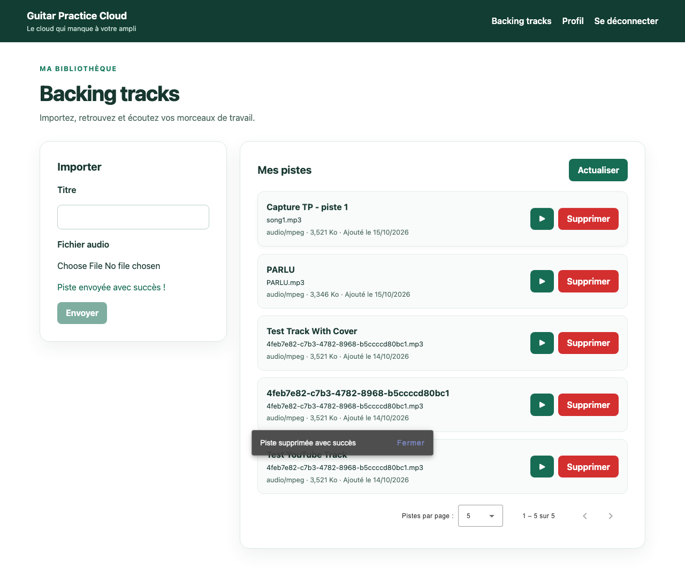
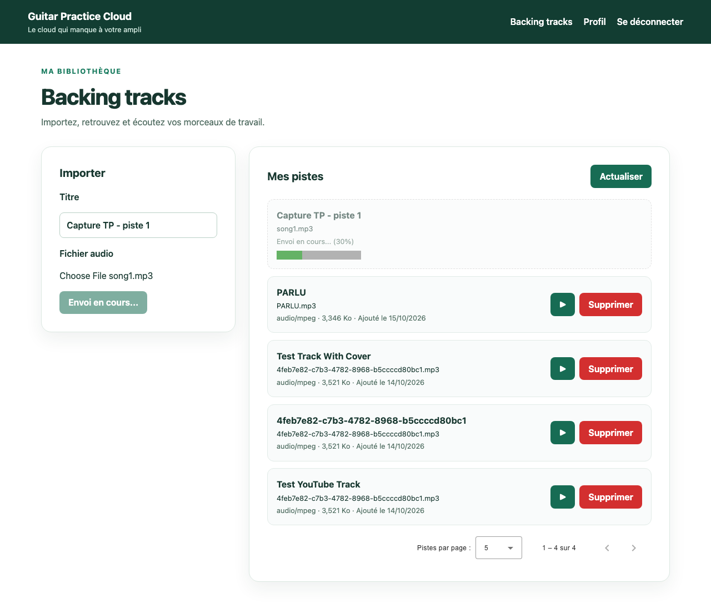
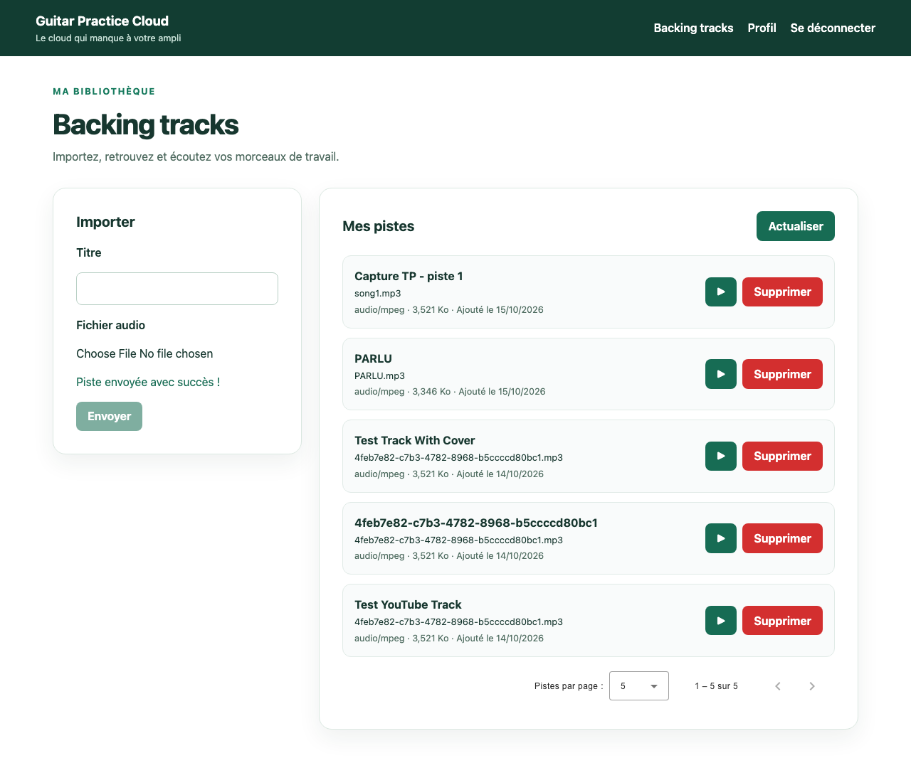

# Rapport d'usage de l'IA et livrables — TP1, TP2, TP3

Pour chaque mission, détailler et fournir des explications concernant : objectif; prompt principal; plan proposé par l'agent; vérifications réalisées par le binôme; erreurs ou propositions rejetées; fichiers effectivement modifiés; preuve de fonctionnement; ce que chaque membre sait maintenant expliquer sans l'agent.

## Outils IA utilisés

Nous avons utilisé **Claude Opus 5.5** dans Claude Code pour le code, et **Claude Haiku** pour les questions simples. Pour chaque mission, nous demandions d'abord à l'agent un plan d'implémentation (une spécification), et nous le validions avant qu'il écrive le code.

---

# TP1 — Authentification et profil

## Cartographie

| Élément | Fichier |
|---|---|
| Composant racine | [`app.ts`](frontend-starter/src/app/components/app/app.ts) |
| Démarrage, `HttpClient`, intercepteur | [`main.ts`](frontend-starter/src/main.ts) |
| Routes | [`routes.ts`](frontend-starter/src/app/routes.ts) |
| Services | [`auth.service.ts`](frontend-starter/src/app/shared/services/auth.service.ts), [`track.service.ts`](frontend-starter/src/app/shared/services/track.service.ts) |
| Ajout du JWT | [`auth.interceptor.ts`](frontend-starter/src/app/shared/interceptors/auth.interceptor.ts) |
| Protection des pages | [`auth.guard.ts`](frontend-starter/src/app/shared/guards/auth.guard.ts) |

Les routes publiques sont `/api/health`, `/api/auth/register` et `/api/auth/login`. Toutes les autres routes demandent un JWT.

## Flux « Se connecter »

Angular ne parle jamais à MongoDB : seul le backend y accède.

## Mise à jour du profil

- **Front** : `profile-page` (`save()`), puis `AuthService.update()` → `PUT /api/users/me`.
- **Back** : `app.put("/api/users/me", auth, …)` dans [`app.js`](backend/src/app.js#L249), qui appelle `User.findByIdAndUpdate`.

## Checkpoint Network TP1

| Cas | Requête | Statut | `Authorization` |
|---|---|---|---|
| Mauvais mot de passe | `POST /api/auth/login` | 401 | absent |
| Connexion | `POST /api/auth/login` | 200 | absent |
| Profil | `GET /api/users/me` | 200 | `Bearer …` |
| Modification du nom | `PUT /api/users/me` | 200 | `Bearer …` |

Les traces du backend s'affichent dans le terminal où tourne `npm start`.

| Connexion refusée | Connexion réussie | Profil modifié |
|---|---|---|
|  |  |  |

## Signal ou `localStorage`

- Le `localStorage` garde le token après un rechargement, mais Angular ne voit pas quand il change.
- Un Signal est réactif (l'interface se met à jour), mais il est vidé à chaque rechargement.
- On utilise donc le `localStorage` pour garder le token, et les Signals pour piloter l'interface.

## Rapport IA — TP1

- **Objectif** : inscription, connexion, déconnexion et profil.
- **Prompt principal** : « Voici le sujet du TP1 et le contrat de l'API. Fais-moi d'abord un plan pour l'inscription et la connexion avec des formulaires réactifs et des Signals, sans toucher au backend. »
- **Plan proposé** : formulaires réactifs, `AuthService` qui enregistre le token, menu qui change selon l'utilisateur connecté, puis la page profil.
- **Vérifications** : tests dans le navigateur, onglet Network, `npm test`.
- **Erreurs rejetées** : un mot de passe de 6 caractères minimum au lieu de 8 (la règle du backend), et la perte de l'utilisateur affiché après F5.
- **Fichiers modifiés** : `app/*`, `login-page/*`, `register-page/*`, `profile-page/*`, `styles.css`.
- **Preuve** : captures et tableau Network ci-dessus.
- **Ce qu'on sait expliquer** : le trajet d'une connexion, la différence entre Signal et `localStorage`, et le rôle de l'intercepteur et du guard.

---

# TP2 — Bibliothèque, upload et lecture audio

## Pagination

`TrackService.list(page, limit)` envoie `page` et `limit` au backend. Chaque changement de page refait donc une requête (`GET /api/tracks?page=2&limit=5`). Rien n'est découpé côté Angular.

## Où se trouve chaque étape

| Étape | Où |
|---|---|
| Choix du fichier | `tracks-page` → `choose()` |
| `FormData` et upload | `TrackService.upload()` |
| Récupération du `Blob` | `TrackService.audio(id)` avec `responseType: 'blob'` |
| `ObjectURL` | `play()` avec `URL.createObjectURL` |
| Révocation | dans `play()` et à la destruction du composant |

**Pourquoi `<audio src="/api/...">` ne reçoit pas le JWT ?** Dans ce cas, c'est le navigateur qui télécharge le fichier, pas `HttpClient`. L'intercepteur ne passe donc pas, et le backend répond 401.

**Contrôles côté backend** : 25 Mo maximum, liste de types MIME autorisés, fichier obligatoire (sinon 400). Le front fait les mêmes contrôles pour que l'utilisateur voie l'erreur tout de suite, mais seul le backend fait foi, car le contrôle du front peut être contourné.

## Mémoire et streaming

- Le backend ne charge pas tout le fichier en mémoire : `res.sendFile` l'envoie par morceaux.
- Avec `responseType: 'blob'`, le composant reçoit le fichier seulement quand il est entièrement téléchargé.
- Avec 100 morceaux, seule la liste de la page (5 pistes en JSON) est chargée. L'audio n'est téléchargé qu'au clic sur « Lire ».
- Il faut révoquer l'`ObjectURL`, sinon le navigateur garde le fichier en mémoire.

## Checkpoint Network TP2

| Vérification | Résultat |
|---|---|
| Le changement de page modifie `page` | 200 |
| L'upload est en multipart (`audio`, `title`) | 201 |
| La lecture renvoie un flux audio | 200 |
| Un fichier invalide est refusé | 400 |

## Rapport IA — TP2

- **Objectif** : pagination côté serveur, upload, lecture audio et cards.
- **Prompt principal** : « Fais un plan pour la pagination côté serveur avec des Signals. Je veux que chaque changement de page refasse une requête au backend. Explique-moi aussi pourquoi on passe par un Blob pour lire l'audio. »
- **Plan proposé** : envoi des paramètres dans `list()`, ajout de Signals et du paginator, validation du fichier, lecture avec `Blob` et `ObjectURL`.
- **Vérifications** : requêtes `page=1` puis `page=2` dans Network, upload puis lecture d'une piste, envoi d'un fichier non audio.
- **Erreurs rejetées** : une pagination qui découpait la liste côté Angular, et l'idée de mettre le token dans l'URL de l'audio.
- **Fichiers modifiés** : `tracks-page.*`, `track.service.ts`, `styles.css`.
- **Preuve** : captures et tableau Network ci-dessus.
- **Ce qu'on sait expliquer** : le passage `Blob` → `ObjectURL`, pourquoi `src` n'envoie pas le JWT, et pourquoi on valide le fichier côté front et côté back.

---

# TP3 — Suppression, progression et tests

## Suppression

- Le bouton « Supprimer » demande une confirmation, puis appelle `TrackService.delete(id)`.
- Le bouton est désactivé pendant l'appel, et un SnackBar affiche le résultat. La liste est ensuite rechargée.
- Le backend vérifie le JWT et ne supprime que les pistes de l'utilisateur connecté. Pour la piste d'un autre utilisateur, il répond 404.
- Le guard ne suffit pas, car on peut appeler l'API directement sans passer par Angular.

## Progression de l'upload

`upload()` utilise `reportProgress: true` et `observe: 'events'`, avec `withXhr()` dans `main.ts`. Une requête classique renvoie une seule réponse. Ici, on reçoit plusieurs événements de progression, puis la réponse finale. La réussite n'est affichée qu'à la réception de cette réponse.

| En cours | Réussi |
|---|---|
|  |  |

## Rapport des tests

Les tests utilisent `HttpTestingController` : ils n'ont besoin ni du backend ni de MongoDB.

| Test | Vérifie | Résultat |
|---|---|---|
| `AuthService.login` | `POST /api/auth/login`, puis token enregistré | ✅ |
| `TrackService.list` | `GET /api/tracks?page=2&limit=10` | ✅ |
| `TrackService.upload` | multipart avec `audio` et `title` | ✅ |
| Intercepteur | header `Authorization: Bearer …` | ✅ |
| Guard | redirige vers `/login` sans token | ✅ |
| Suppression | un seul `DELETE`, puis rechargement | ✅ |
| Erreurs de suppression | 404, 403 et 401 gérés | ✅ |
| Progression | pourcentage affiché, pas de succès avant la réponse | ✅ |

## Restitution orale

1. **Pourquoi passer par un service ?** Le composant gère l'affichage et le service gère le HTTP. C'est plus simple à tester.
2. **Comment le backend protège-t-il la suppression ?** Il vérifie le JWT, puis filtre sur le propriétaire de la piste.
3. **Comment est calculé le pourcentage ?** `Math.round(100 × loaded / total)`.
4. **Pourquoi les tests n'ont-ils pas besoin de MongoDB ?** Les requêtes sont interceptées et reçoivent une fausse réponse.
5. **Que vérifie un test d'intercepteur ou de guard ?** Pour l'intercepteur, la présence du header JWT. Pour le guard, la redirection vers `/login` sans token.
6. **Test unitaire ou test d'intégration ?** Un test unitaire teste une seule partie de l'application. Un test d'intégration en fait fonctionner plusieurs ensemble.

## Rapport IA — TP3

- **Objectif** : suppression d'une piste, progression de l'upload et tests.
- **Prompt principal** : « Pour la mission 5, propose un plan pour supprimer une piste avec une confirmation et un message de succès ou d'erreur. Explique aussi comment le backend empêche de supprimer la piste de quelqu'un d'autre. »
- **Plan proposé** : `TrackService.delete()`, un état `deleting`, un SnackBar, la progression avec `withXhr()`, puis les tests avec `HttpTestingController`.
- **Vérifications** : `npm test`, `npm run build`, suppression et upload dans le navigateur.
- **Erreurs rejetées** : un succès affiché dès 100 % au lieu d'attendre la réponse, une progression bloquée à 0 sans `withXhr()`, et des tests qui plantaient à cause de `localStorage`.
- **Fichiers modifiés** : `tracks-page.*`, `track.service.ts`, `*.spec.ts`, `main.ts`, `package.json`.
- **Preuve** : captures et tableau des tests ci-dessus.
- **Ce qu'on sait expliquer** : les réponses de la restitution orale.
